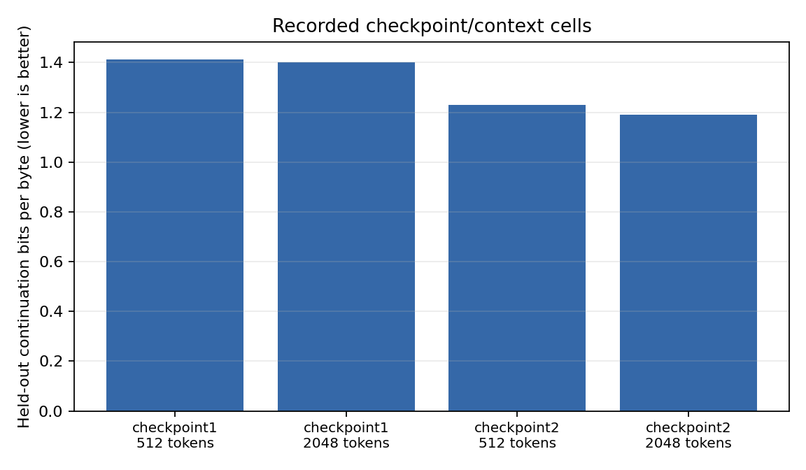
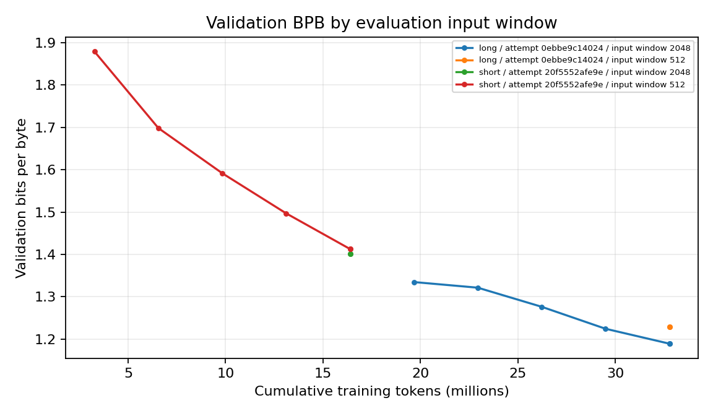

# Part 4: extending FoX from 512 to 2048 tokens

Completed on November 4, 2026. Research run: `fox-seed42-v1`, seed 42.
The tiny persistence rehearsal is excluded from all model-quality results below.

## Why train short first?

We selected a 512-token initial window, matching the team's inexpensive picochat
setting, and increased it fourfold to the assignment's 2048-token target.
[Shortformer](https://aclanthology.org/2021.acl-long.427/) motivates training on
shorter subsequences before switching to longer inputs; its experiments found
efficiency and perplexity benefits in their setting.
[Sequence Length Warmup](https://arxiv.org/abs/2108.06084) provides a complementary
stability rationale for beginning with shorter sequences. These findings motivate
the curriculum; they do not guarantee an improvement for this FoX adaptation.

The model retained FoX forgetting gates without RoPE, six layers, width 384, six
heads and a 32,768-token vocabulary: **73,545,506 parameters**. Both stages used
the same architecture, tokenizer and upstream Muon/AdamW recipe. We increased
input length and the associated context-derived SSSL attention windows without
changing learned parameter shapes. This was continued pretraining from the first
checkpoint, rather than a new initialization.

## Configuration check against Part 2

We checked [Jinhao's saved pilot records](../pilot_results/sweep.json),
[`pico/variants.py`](../pico/variants.py), and our checkpoint/config
provenance. The Part 2 and Part 4 FoX source SHA-256 is the same:
`a5e9f85e3d63972b1bf0e1015208f048b557fb97f48bc71b0f8f38cadefe4b70`.
Part 1's original nanochat diagram is explicitly labeled historical in the
team draft; its **July baseline** is the reference actually used in Part 2
and inherited by our FoX configuration.

| Setting | Part 2 reference | Part 2 FoX | Part 4 FoX |
|---|---:|---:|---:|
| Layers / width / query heads / KV heads | 6 / 384 / 6 / 6 | 6 / 384 / 6 / 6 | 6 / 384 / 6 / 6 |
| Vocabulary / initial context | 32,768 / 512 | 32,768 / 512 | 32,768 / 512 |
| Parameters | 73,531,646 | 73,545,506 | **73,545,506** |
| Attention architecture | July nanochat, RoPE | FoX gates, no RoPE | Same FoX gates, no RoPE |
| Upstream commit / window pattern | `92d63d4` / SSSL | `92d63d4` / SSSL | `92d63d4` / SSSL |

The 13,860 extra parameters versus the unmodified Part 2 reference are the
existing FoX adaptation. Part 4 did **not** enlarge the model. Its only planned
model configuration change is the context length and corresponding SSSL windows
at checkpoint 2; learned parameter shapes stay fixed. Both Part 2 and Part 4
used seed 42, BF16, H100, 32,768 tokens per update and 500 short-context steps.
Capacity alignment therefore requires **no new training**.

The runs are not otherwise identical: Part 4 fitted a fresh tokenizer, used a
sequential BOS-separated training stream instead of Jinhao's best-fit loader,
and used a 1000-step global learning-rate schedule whose warmdown begins at
step 700 rather than the Part 2 pilot's 500-step schedule beginning at step 175.
Our C1 starts from a fresh initialization, not Jinhao's saved Part 2 weights.
These differences prevent a direct numerical Part 2-to-Part 4 BPB comparison.

## Data and continuation protocol

Nanochat was pinned to `92d63d4e8bb4df75c3b71618f31ddde2378b2bcd`; ClimbMix was
pinned to `915333b4f8b8684f39aeaafea600fea6f43fb703`. Four training shards and the
separate held-out shard 6542 were downloaded. The selected 40M-token stream used
63,759 documents from shard 0. The tokenizer was fitted on 100M characters from
38,015 training documents, also from shard 0. Full-text hashes of documents used
for either fitting or training were excluded from evaluation; no exact matches
were encountered among the selected held-out examples. Near duplicates were not
explicitly detected.

Training used a deterministic BOS-separated stream. This differs from Part 2's
best-fit cropper and enables exact cursor restoration across context/batch shapes.
The fresh tokenizer, evaluation cohort and global schedule also differ from the
Part 2 pilot, so its BPB values are not a directly matched baseline here.

| Setting | Stage 1 / checkpoint 1 | Stage 2 / checkpoint 2 |
|---|---:|---:|
| Training context | 512 | 2048 |
| Global steps | 1–500 | 501–1000 |
| Tokens per update | 32,768 | 32,768 |
| Tokens trained in stage | 16,384,000 | 16,384,000 |
| Cumulative training tokens | 16,384,000 | 32,768,000 |
| Microbatch × accumulation | 8 × 8 | 2 × 8 |
| Timed optimization steps, seconds | 88.19 | 147.62 |
| Trainer elapsed time, seconds | 254.37 | 347.83 |
| Steady tokens/s, excluding first five steps | 231,573 | 128,548 |
| Peak allocated GPU memory, GiB | 3.64 | 4.94 |

Both stages used one NVIDIA H100 80GB HBM3, BF16, four requested CPU cores and
16 GiB host memory. Optimization-step time excludes checkpointing and evaluation;
trainer elapsed time includes those operations but stops before final tracking
and report finalization. The global learning-rate schedule used 20 warmup steps,
then began warmdown at global step 700; it was not restarted at the boundary.

Checkpoint 2 restored the optimizer, RNG states, global step and exact stream
cursor from checkpoint 1. Before its first update, the code verified that loaded
learned tensors matched the saved parent. Both final checkpoints were reloaded
and checksum-verified in fresh CPU workers. The recorded parent SHA-256 is
`98e30216bf74de1a817a9b29d576781f6c676be79876f4da7a90e9cabc4ca03e`.

## Standard nanochat validation of our FoX checkpoints

We rescored the saved FoX C1 and C2 with nanochat's `evaluate_bpb`
function and BOS best-fit validation loader, using the Part 2 protocol's
262,144 nominal target positions per cell. At a given evaluation context,
both checkpoints scored identical frozen input and target batches from the
held-out shard. The original Part 4 tokenizer remains attached to both models.

| FoX checkpoint | Standard BPB at 512 | Standard BPB at 2048 |
|---|---:|---:|
| C1, trained at 512 | 1.445817 | 1.395753 |
| C2, continued at 2048 | **1.280513** | **1.214471** |

At fixed 512 evaluation, C2 improves by 0.165304 BPB; at fixed 2048, it
improves by 0.181282 BPB. C2 also received another 16.384M training tokens
and a later learning-rate schedule, so this does not isolate context training.
The best-fit validation streams differ between 512 and 2048. Their scores
must **not** be subtracted to estimate the effect of a longer input.

The procedure, metric and nominal budget match Jinhao's Part 2 validation.
His original tokenizer and validation-input hashes were unavailable, so the
numbers are **not** an exact reproduction of his historical inputs or scores.
[Frozen input hashes, per-batch results and fresh-worker verification](results/standard-validation-seed42-v1/)
are saved. This section reports only the FoX checkpoints; Part 2 already
covers the architecture comparison with its reference model.

## New evaluation: matched-target document continuation

We froze 64 sufficiently long documents from the held-out shard before research
training. Each example contains 2049 tokens. For each checkpoint, we evaluated
input windows of 512 and 2048 while scoring the **same final 128 target tokens**.
Each cell therefore scores 8,192 target tokens representing 37,180 raw UTF-8
bytes. The input-window length includes preceding target history. This is a
conditional text-continuation likelihood task, rather than an instruction-following
or chat benchmark.

The metric is pooled bits per byte (BPB): total scored negative log-likelihood
in nats divided by `ln(2) × scored UTF-8 bytes`. Special tokens have zero byte
weight. We aggregate totals rather than taking an unweighted mean of document
BPBs. At each evaluation length, both checkpoints receive the same explicit SSSL
window policy. Checkpoint 1 at 2048 is outside its training input range.

| Checkpoint | Evaluation window 512 | Evaluation window 2048 |
|---|---:|---:|
| Checkpoint 1: trained at 512 | 1.412895 | 1.401852 |
| Checkpoint 2: continued at 2048 | **1.228746** | **1.189348** |

Lower BPB is better. At the fixed 2048-token evaluation condition, checkpoint 2
improved by **0.212504 BPB (15.16%)**. Its 512-token score also improved, showing
no observed short-context regression on this cohort.

Within checkpoint 1, the longer evaluation window improved BPB by 0.011042.
Within checkpoint 2, it improved BPB by **0.039398 (3.21%)**. Thus the later model
made greater measured use of the longer configured input on this task.

An exploratory paired document bootstrap (10,000 resamples, seed 20261104) gave
95% intervals of [0.006425, 0.016366] and [0.025721, 0.054636] for those respective
within-checkpoint BPB benefits. These quantify evaluation-cohort variability,
not training-seed variability; only one research seed was trained.

## Interpretation and limits

The short-to-long run completed successfully, improved continuation likelihood
and retained short-context performance. However, checkpoint 2 received another
16.384M training tokens and a different part of the global learning-rate schedule.
There is no equal-token continuation control that stays at 512, so before/after
improvements cannot be attributed exclusively to the increased training window.

Changing evaluation length also scales the local SSSL attention windows. The
within-checkpoint contrasts measure the configured context system, rather than
isolating distant-prefix length with every local receptive field held fixed.
The cohort selects long documents and scores only a suffix; it does not establish
retrieval, conversational, instruction-following or general ability improvements.
One training seed, possible near duplicates and a small held-out cohort limit
generalization. The bootstrap intervals do not resolve these limitations.

## Cost, visibility and saved evidence

The research trainer timers imply approximately **US$0.7136** of requested GPU,
CPU and RAM usage: US$0.3014 for stage 1 and US$0.4122 for stage 2, using the
recorded rates. This is **not the total bill or a credit-deduction statement**.
It excludes image builds/startup, CPU preparation, the persistence rehearsal,
fresh-worker checks, report/tracking finalization, storage and export overhead.
Actual gross usage and applied credits must be reconciled in Modal Usage &
Billing. The authorized project ceiling is US$100; conservative launch reservations
are recorded separately and are not presented as money spent.

- [Stage 1 W&B run](https://wandb.ai/jerry-zeng-university-of-toronto/a3-p4-context-extension/runs/qir04bbn)
- [Stage 2 W&B run](https://wandb.ai/jerry-zeng-university-of-toronto/a3-p4-context-extension/runs/cme5uo1s)
- [Stage 1 Modal run](https://modal.com/apps/jerry-zeng-uoft/main/ap-uZH2c9bOtYyhc69myVbCJW)
- [Stage 2 Modal run](https://modal.com/apps/jerry-zeng-uoft/main/ap-qEDDC683kkkCHEMPj8hOBd)
- [Machine-readable tables, figures and provenance](results/fox-seed42-v1/)
- [Detailed protocol and literature rationale](METHODS.md)

W&B training and final-evaluation histories were read back through the API.
The persistent Modal Volume `a3-p4-context` holds full data, both final model
checkpoints, the latest two recovery checkpoints and raw logs/per-target evidence.
Small local exports verify selected file hashes and preserve the full remote
artifact index. Large weights and datasets are not downloaded by default and
are ignored by Git; only code and small research deliverables need to be pushed.
