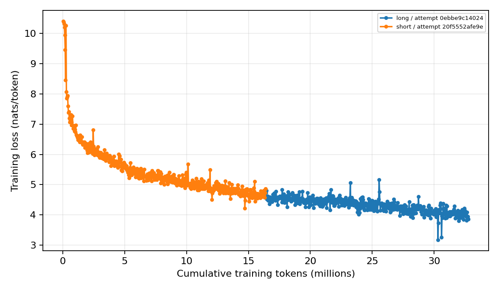
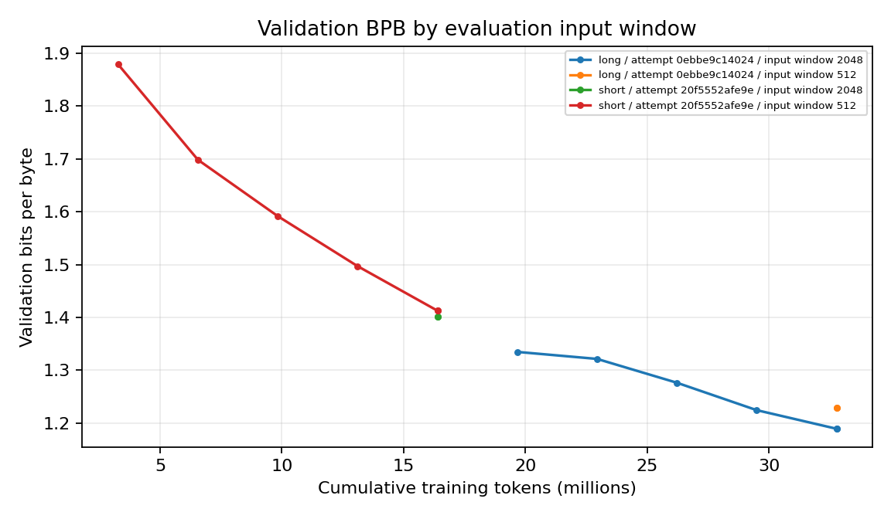
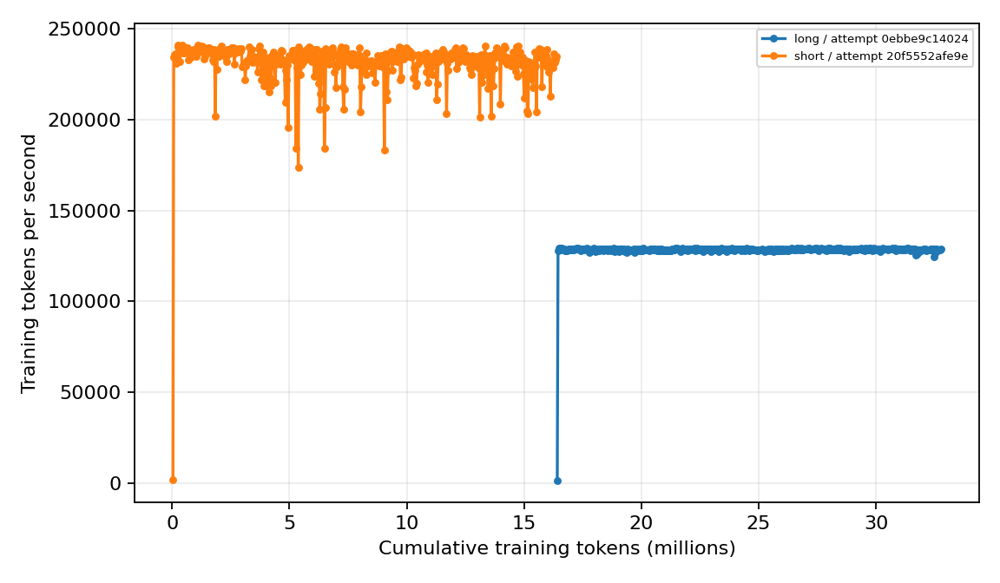
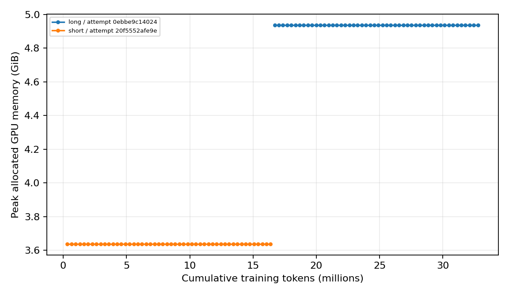
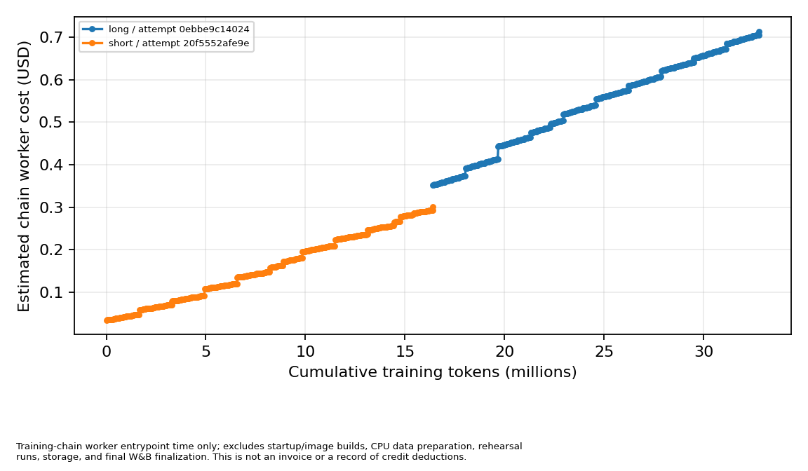
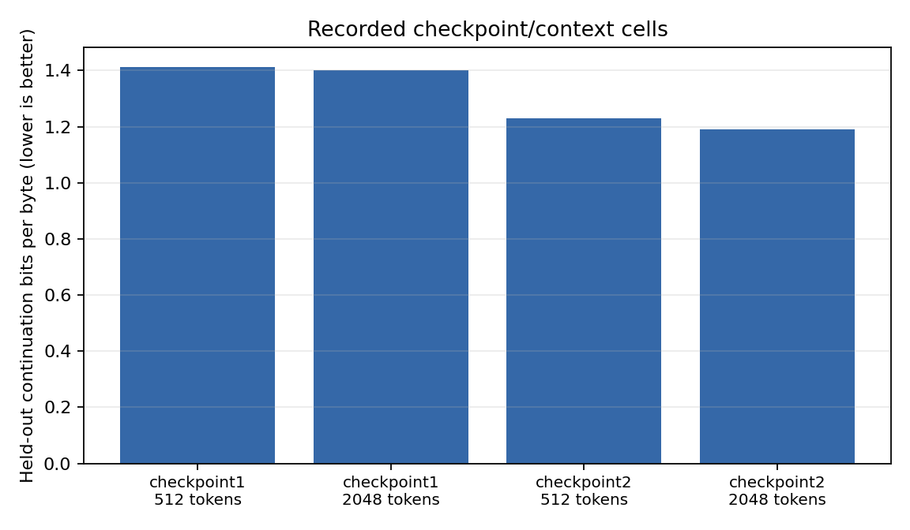

# Part 4 saved-evidence report

Evaluation status: **complete**.

| Checkpoint | Input window | Examples | BPB |
|---|---:|---:|---:|
| checkpoint1 | 512 | 64 | 1.412895 |
| checkpoint1 | 2048 | 64 | 1.401852 |
| checkpoint2 | 512 | 64 | 1.228746 |
| checkpoint2 | 2048 | 64 | 1.189348 |

## Interpretation

- Checkpoint 2 has additional training tokens; before/after differences do not isolate context length as the only cause.
- Checkpoint 1 evaluated at a larger input window is outside its training context range.
- Training-chain worker entrypoint time only; excludes startup/image builds, CPU data preparation, rehearsal runs, storage, and final W&B finalization. This is not an invoice or a record of credit deductions.
- Matched target suffixes are scored; input window length includes preceding target tokens.

## Plotting policy

- Separate explicit evaluation-input-window series; generic legacy metrics retain stage/context labels.
- Separate worker attempts and stages, in saved log order; do not join rolled-back progress trajectories.
- Rows missing attempt/context inherit the latest identified worker/context in that stage's saved log; inference is flagged in CSV.
- Original JSONL files are unchanged; raw_metric_json also preserves each selected source record in CSV.

## Figures

Full per-example token IDs/losses remain in the source JSONL files. CSV files are convenient summaries.
